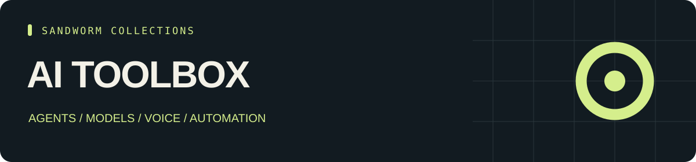

<p align="center"></p>

<p align="center"><b>0 skill entries · 44 tools · 44 source repositories</b></p>

# Sandworm AI Toolbox

A directory of practical AI tools and frameworks, from personal agents and local inference to voice, documents, coding, and observability.

คลังเครื่องมือ AI สำหรับเลือกและเปรียบเทียบตามงาน ตั้งแต่ Agent, local models, voice, browser, เอกสาร ไปจนถึง model operations

[ภาษาไทย](README.th.md) · [Tools](TOOLS.md) · [Start here](docs/start-here.md) · [Sources](SOURCES.md) · [Collection hub](https://github.com/Sandworm-Lazarus/sandworm-arsenal)

## What is inside

| Tool category | Projects |
| --- | ---: |
| Personal agents | 2 |
| Agent frameworks | 4 |
| Visual workflows | 3 |
| Local inference | 4 |
| Chat workspaces | 2 |
| Agent memory | 2 |
| Browser automation | 3 |
| Document ingestion | 5 |
| RAG & vector search | 3 |
| Voice & audio | 4 |
| Image workflows | 2 |
| Coding agents | 3 |
| Training & fine-tuning | 2 |
| Observability | 2 |
| Model gateways | 1 |
| AI evaluation | 2 |

## Use the collection

Browse the pinned source links and use the task paths in [Start here](docs/start-here.md). The offline CLI requires Python 3.9+ and no third-party dependencies.

```bash
git clone https://github.com/Sandworm-Lazarus/sandworm-ai-toolbox.git
cd sandworm-ai-toolbox
python3 scripts/arsenal.py tools "" --json
python3 scripts/arsenal.py stats
python3 scripts/arsenal.py check
```

On Windows, use `py -3` if `python3` is unavailable.

## Evidence and reuse

Entry and Overview labels retain the inspection scope from the original research. Tool records are README overviews. No upstream installation, runtime certification, or benchmark result is claimed. [Review coverage](docs/review-status.md) records this collection's counts.

Original summaries, artwork, CLI and guides are [MIT licensed](LICENSE). Linked projects retain their own licenses; inspect [source/license notes](SOURCES.md) before copying or deploying external packages. This collection contains original curation and links, not upstream bundles.

## Related collections

- [Agent Skills](https://github.com/Sandworm-Lazarus/sandworm-agent-skills)
- [Cyber Arsenal](https://github.com/Sandworm-Lazarus/sandworm-cyber-arsenal)
- [LLM Lab](https://github.com/Sandworm-Lazarus/sandworm-llm-lab)
- [Dev Playbooks](https://github.com/Sandworm-Lazarus/sandworm-dev-playbooks)

Selections overlap where tools support multiple tasks. Do not add collection counts together to infer a unique total.
