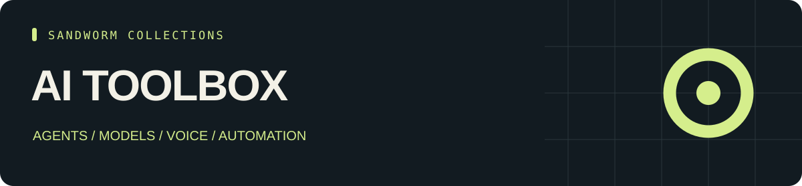

<p align="center"></p>

<p align="center"><b>49 AI tools · 19 categories · 49 source repositories</b></p>

# Sandworm AI Toolbox

คลังเครื่องมือ AI สำหรับเลือกและเปรียบเทียบตามงาน ตั้งแต่ Agent, local models, voice, browser, เอกสาร ไปจนถึง model operations

[English](README.md) · [Tools](TOOLS.md) · [Start here](docs/start-here.md) · [Sources](SOURCES.md) · [หน้ารวมทุกคลัง](https://github.com/Sandworm-Lazarus/sandworm-arsenal)

คลังนี้รวมเครื่องมือ AI 49 ตัว พร้อมลิงก์ที่ตรึง commit และคำอธิบายการใช้งาน อ่าน [เส้นทางเริ่มต้น](docs/start-here.md) เพื่อเลือกตามโจทย์

## เครื่องมือที่พัฒนาเอง: AI Workload Budget Calculator

คำนวณต้นทุน API จาก workload และราคาที่ผู้ใช้ระบุ [Guide](docs/original-tool.md) · [Original work](ORIGINAL_WORK.md).

```bash
python3 scripts/ai_budget.py examples/workload.json
python3 -m unittest discover -s tests -v
```

## ค้นหาและตรวจข้อมูล

ใช้ Python 3.9+ โดยไม่ต้องติดตั้ง dependencies เพิ่ม

```bash
python3 scripts/arsenal.py tools "" --json
python3 scripts/arsenal.py stats
python3 scripts/arsenal.py check
```

## ระดับการตรวจ

Entry หมายถึงเคยอ่านไฟล์ entry ในงานรีเสิร์ชต้นทาง ส่วน Overview หมายถึงตรวจ frontmatter และเนื้อหาช่วงต้น เครื่องมือเป็นการตรวจภาพรวม README ไม่ได้รันทดสอบแพ็กเกจต้นทาง ดู [coverage](docs/review-status.md) ของคลังนี้ได้

งานคัดสรรและคู่มือของเราใช้ [MIT](LICENSE) ส่วนผลงานภายนอกใช้ license ของเจ้าของตาม [SOURCES.md](SOURCES.md) การอยู่ในคลังไม่ได้แปลว่าเป็นผลงานที่เราเขียนทั้งหมด

เครื่องมือบางตัวอยู่ได้มากกว่าหนึ่งคลังตามบริบทการใช้งาน จึงไม่ควรนำจำนวนจากทุก repo มาบวกเป็นจำนวนโครงการไม่ซ้ำ
